I'm an AI product engineer based in İzmir. I build software products end to end: I shape what a product should do, lead the team that builds it and write the code, with AI in every step. I'm finishing my Software Engineering degree at Fırat University. [Portfolio](https://ozenyunus35.github.io/yunus-ozen-portfolio/) · [LinkedIn](https://www.linkedin.com/in/yunus-ozen/)

### Selected work

<!-- selected-work:start -->

<!-- selected-work:end -->

### Live demos

Products I built end to end. Each one runs in the browser with synthetic data and ships with tests.

| Project | What it does | Stack | Links |
| --- | --- | --- | --- |
| **Folio** | Double-entry bookkeeping in the browser: journal, ledger, statements, invoices, VAT, currency revaluation and year-end close, in the international or Turkish chart of accounts | Next.js | [Demo](https://ozenyunus35.github.io/double-entry-ledger/) · [Code](https://github.com/ozenyunus35/double-entry-ledger) |
| **Quarry** | Ask a database in English or Turkish and get readable SQL, charts and checks: its own text-to-SQL engine with SQLite in the browser | Next.js | [Demo](https://ozenyunus35.github.io/sql-copilot/) · [Code](https://github.com/ozenyunus35/sql-copilot) |
| **Tally** | Reads invoices, receipts and bank statements in the browser: OCR, VAT and balance checks, payment matching, Excel export | TypeScript | [Demo](https://ozenyunus35.github.io/invoice-extractor/) · [Code](https://github.com/ozenyunus35/invoice-extractor) |
| **Relay** | AI support assistant that answers from help articles with sources and hands off to a person when unsure | Next.js | [Demo](https://ozenyunus35.github.io/ai-support-assistant/) · [Code](https://github.com/ozenyunus35/ai-support-assistant) |
| **Atlas Portal** | Admin dashboard and client file portal with roles, quotas, share links and an activity log | Next.js | [Demo](https://ozenyunus35.github.io/admin-file-portal/) · [Code](https://github.com/ozenyunus35/admin-file-portal) |
| **Cadence** | Salon booking page with real-time availability and a drag-to-reschedule staff calendar | Next.js | [Demo](https://ozenyunus35.github.io/booking-scheduler/) · [Code](https://github.com/ozenyunus35/booking-scheduler) |
| **Fieldline** | Field-service app for technicians with checklists, signatures, van stock and offline sync | Flutter | [Demo](https://ozenyunus35.github.io/field-service-app/) · [Code](https://github.com/ozenyunus35/field-service-app) |
| **PDF to Excel** | Turns tables in PDF reports into clean, formatted Excel workbooks | TypeScript | [Demo](https://ozenyunus35.github.io/pdf-data-extractor/) · [Code](https://github.com/ozenyunus35/pdf-data-extractor) |
| **Lead Scraper** | Daily crawler that turns a business directory into a clean Excel lead list | Python | [Demo](https://ozenyunus35.github.io/lead-scraper/) · [Code](https://github.com/ozenyunus35/lead-scraper) |

### Recognition

With team Innosoft I took 1st place in Elazığ at the 2022 NASA International Space Apps Challenge, with *Wink to the Future*, a Flutter app built in 48 hours. [Repository](https://github.com/ozenyunus35/WINK-TO-THE-FUTURE-INNOSOFT) · [Demo](https://youtu.be/xPwoLuFRq8w)

### Toolbox

### Open source

I also fix bugs in the tools developers use every day. These cards rebuild themselves from the GitHub API every few hours.

<b>Latest merge in each project</b>

 

<b>Highlights</b>

 

| Project | Contribution |
| --- | --- |
| [Grafana](https://github.com/grafana/grafana) | Kept trace resources apart when exporting a trace as OTLP JSON |
| [Nuxt](https://github.com/nuxt/nuxt) | Fixed the scroll offset for anchors whose IDs start with a number |
| [Gitea](https://github.com/go-gitea/gitea) | Commit-to-user matching with empty emails; inline math parsing |
| [uutils coreutils](https://github.com/uutils/coreutils) | GNU-compatibility fixes in Rust across `sort`, `od`, `ls`, `cut`, `join`, `split` and more |
| [oxc](https://github.com/oxc-project/oxc) | ESLint rule fixes in the Rust linter |
| [OpenTelemetry JS](https://github.com/open-telemetry/opentelemetry-js-contrib) | Recorded every GC entry in the Node runtime instrumentation |
| [devenv](https://github.com/cachix/devenv) | Process startup, file watcher and `PATH` fixes; detach from the TUI with `q` |
| [Harper](https://github.com/Automattic/harper) | New grammar rules for the Rust grammar checker |
| [ts-proto](https://github.com/stephenh/ts-proto) | Features and fixes in the protobuf-to-TypeScript generator |
| [repowise](https://github.com/repowise-dev/repowise) | Code analysis: type inference for C#, Kotlin and Swift, dead-code roots |

[All merged pull requests →](https://github.com/search?q=author%3Aozenyunus35+is%3Apr+is%3Amerged&type=pullrequests)

